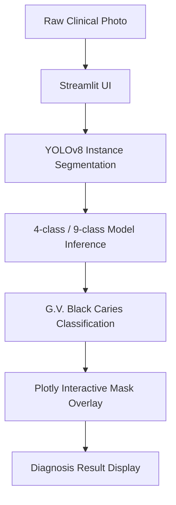
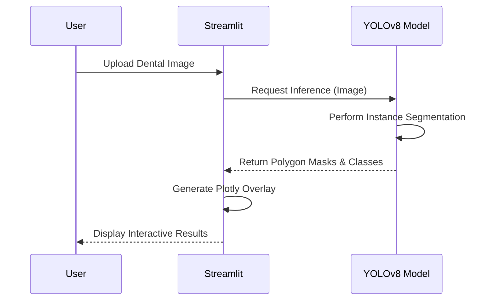

    

# 사진을 통한 치아 우식증 탐지 (Caries Detection from Photo - Dental_005)

사진을 통한 치아 우식증 탐지는 YOLOv8 인스턴스 분할(`YOLOv8x-seg`)을 기반으로 한 자동화된 구강 카메라/임상 사진 치아 우식증 탐지 및 진단 보조 시스템입니다.

## 설치 및 실행 방법

### Dataset & Model Checkpoints Setup
이 프로젝트는 대용량 데이터셋과 사전 학습된 모델 가중치(Checkpoints)가 필요합니다. (GitHub에는 소스코드만 올라가 있습니다.)

1. 프로젝트를 클론한 후, 먼저 `setup_env.py` 스크립트를 실행하여 모델 가중치를 허깅페이스에서 다운로드하세요.
   ```bash
   pip install huggingface_hub
   python setup_env.py
   ```
2. [환경 설정 (`.env` 파일)]:
   이 프로젝트를 실행하기 위한 환경변수는 `.env.example`을 참조하여 로컬 `.env` 파일로 구성할 수 있습니다. `src/alphadent/train.py`, `valid.py`, `inference.py`는 `torch.cuda.is_available()`를 동적으로 확인하여 CUDA GPU 또는 CPU로 자동 폴백합니다.

## 기능

- [고정밀 인스턴스 분할]: YOLOv8 아키텍처를 사용하여 G.V. Black 분류법을 기반으로 치아 우식증을 탐지하고 분할합니다.
- [대화형 웹 인터페이스]: Streamlit으로 구축된 사용자 친화적인 웹 UI를 제공하여 실시간 이미지 업로드 및 분석이 가능합니다.
- [고급 시각화]: Plotly를 활용하여 원본 임상 사진을 가리지 않고 대화형의 마우스 오버가 가능한 분할 마스크를 브라우저에 직접 렌더링합니다.
- [이중 모델 지원]: 간소화된 4개 클래스 모델과 상세한 9개 클래스 진단 모델 사이를 매끄럽게 전환할 수 있습니다.

## 설치 및 재현성

### 1. 저장소 클론
저장소를 클론하고 필요한 종속성을 설치합니다:

```bash
git clone https://github.com/HyunchanAn/Dental_005.git
cd Dental_005
pip install -r requirements.txt
```

### 2. 모델 가중치 다운로드
저장소 용량이 과도하게 커지는 것을 방지하기 위해 데이터셋(`data/`), 모델 가중치(`*.pt`), 검증 산출물(`yolo_seg_x_proj_*/`, `predictions.json`) 등은 `.gitignore`를 통해 버전 제어에서 제외됩니다.

- [Hugging Face Repository (`chemahc94/Dental-AI-Models`)](https://huggingface.co/chemahc94/Dental-AI-Models/tree/main/Dental_005)
- [Google Drive: Model Weights](https://drive.google.com/drive/folders/1KnM2z4ssN3THdYu2qqrDZ1JkbAmBbeiw?usp=sharing)

## 사용법

로컬에서 Streamlit 웹 애플리케이션을 시작하려면 다음을 실행합니다:

```bash
streamlit run streamlit_app.py
```

애플리케이션은 `http://localhost:8501`에서 접속할 수 있습니다.

## 개요
> [학습 환경 사양] 실질적 모델 학습은 RTX 5080 + 라이젠9-6 9900X 환경에서 진행되었습니다.

### Architecture Diagram


### Sequence Diagram


## 데이터셋 출처 및 라이선스 규정 (Dataset Terms & Attribution)

- [원본 코드베이스 출처]: [ZFTurbo/AlphaDent](https://github.com/ZFTurbo/AlphaDent) (`MIT License`, `Copyright (c) 2025 Roman Solovyev (ZFTurbo)`).
- [데이터셋 출처 (AlphaDent Kaggle Competition)]: [AlphaDent Dataset (Kaggle Competition)](https://www.kaggle.com/competitions/alpha-dent/data)
  - 본 프로젝트의 학습 및 검증 데이터는 Kaggle AlphaDent Competition 규정(Competition Rules)의 적용을 받습니다.
  - [데이터 및 파생 라벨 비재배포 원칙]: Kaggle 대회 데이터 이용 약관 준수를 위해 본 GitHub 저장소에는 원본 대회 영상, 어노테이션 라벨 파일(`yolo_seg_x_proj_*/labels/*.txt`), 대용량 추론 산출물(`predictions.json`)을 일절 포함하거나 재배포하지 않습니다.
  - 재현 학습 또는 검증을 수행하려는 사용자는 위 Kaggle 대회 페이지에서 직접 대회 규정에 동의(Accept Competition Rules)한 후 로컬 `data/` 폴더에 데이터를 다운로드하여 사용해야 합니다.

## 향후 연구 (Future Work)
- [Phase-Field 기반 분할 향상 및 안정성 연구](docs/Phase_Field_Enhancement.md)

## 가중치 백업 안내
오래된 이전 가중치 파일(Legacy Backups)은 통일성을 위해 `Emergency_Weights_Vault/Dental_005/Backup_Checkpoints` 폴더에 별도로 안전하게 보존되어 있습니다.

## 연구용 실행 주의사항
- 기본 실행 주소: `127.0.0.1` (로컬 전용)
- 외부 공개/상용 배포 금지
- API 키·토큰은 환경변수로만 관리
- 오픈 데이터셋 외 민감 의료데이터 사용 금지
- 외부 접근이 필요하면 `ALLOW_EXTERNAL_ACCESS=true` 로만 명시적 허용
